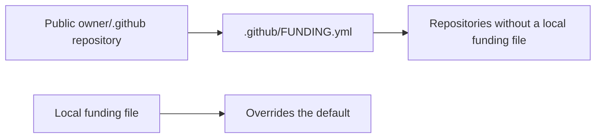

# Funding defaults

The default is account-scoped. Personal and organization owners each need their own public `.github` repository. The file belongs in its `.github` directory on the default branch. Only a public URL is stored; there is no API, runtime service, payment processing, credential access or personal report data.

GitHub references: [default community files](https://docs.github.com/en/communities/setting-up-your-project-for-healthy-contributions/creating-a-default-community-health-file), [Sponsor button](https://docs.github.com/en/repositories/managing-your-repositorys-settings-and-features/customizing-your-repository/displaying-a-sponsor-button-in-your-repository).

Repository-specific governance stays in this guide, not inheritable SECURITY/CONTRIBUTING files or issue templates, to avoid changing policies in unrelated repositories. The one exception, made at the owner's request on 12 Nov 2026 ("adopt the PR checklist everywhere"), is the default pull request template: it only adds a checklist to PRs in repositories that have no template of their own. Issue templates stay per repository.
